# Lumenist

> **Lumenist** is an open-source, self-hosted fine-art photography gallery and modern CMS designed specifically for landscape, nature, and documentary photographers.

Named after the 19th-century **Luminism** art movement—which celebrated the poetic, atmospheric rendering of natural light and landscape—Lumenist is built as a high-performance, distraction-free alternative to legacy platforms like Piwigo and walled-garden portfolio builders.

🌐 **Live Exhibition Example**: See Lumenist running in production at <a href="https://rrkphoto.com" target="_blank" rel="noopener noreferrer"><strong>rrkphoto.com</strong> ↗</a> (*Randal R. Ketchem Photography: Fine Art Landscape and Nature Photography*).

<p align="center">
  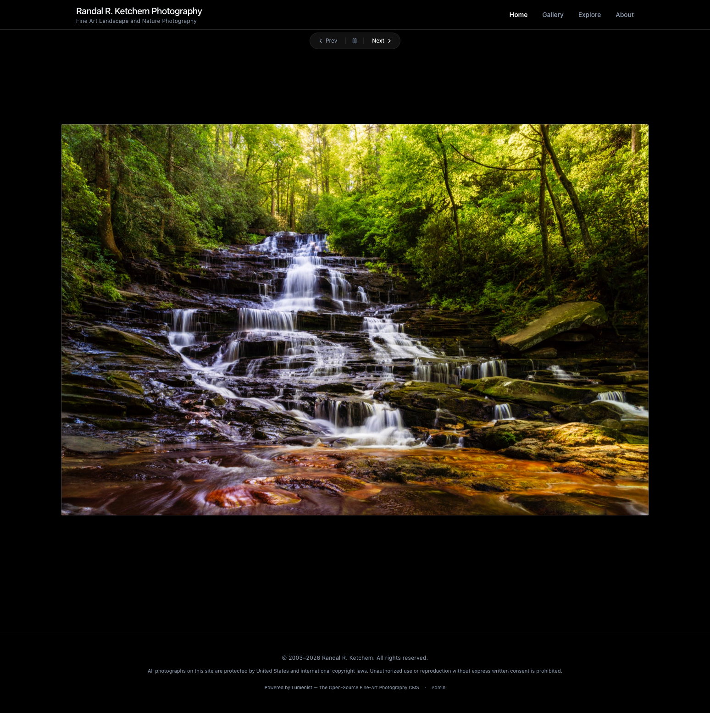
</p>

---

## Public Exhibition Features

### 🏠 Curated Homepage (`/`)
- **Randomized Hero Slideshow**: Dynamically cycles through your archive with timed transitions, custom interval settings, previous/next slide navigation with history tracking, pause/resume controls, and direct links to full technical exhibition details.
- **Unified Galleries Grid**: Displays all curated collections in a clean, responsive card layout. The **"All"** archive is prominently featured as the first gallery (displaying the total collection size), followed by thematic albums (biomes, seasons, subjects). Each card presents a representative, randomly refreshed photograph with dynamic aspect framing and photo title overlays on hover.

### 🖼️ Galleries & Albums (`/galleries/[category]`)

<p align="center">
  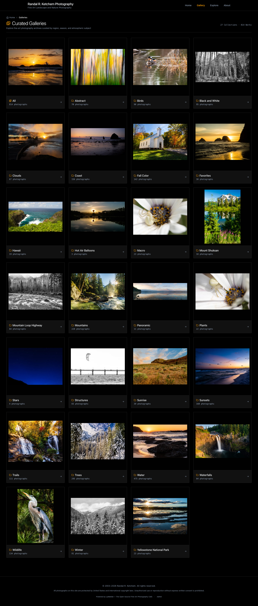
</p>

- **Flicker-Free Layouts (Zero CLS)**: Pre-calculated aspect ratios preserve exact bounding containers before images download, completely eliminating Cumulative Layout Shift.
- **Deep Navigation Trail**: Hierarchical breadcrumb navigation (`Home > [Gallery Name]`) with smart fallback back-buttons for rapid browsing.
- **Exhibition Grid & Pagination**: Responsive thumbnail grids with configurable page sizing (25, 50, 100, or All) and smooth scroll-to-top page navigation.
- **Instant Clean Routing**: Direct navigation to `/galleries` automatically redirects to the homepage `/`.

### 🔍 Instant Explore, Geographic Map & Archive Search (`/explore`)

<p align="center">
  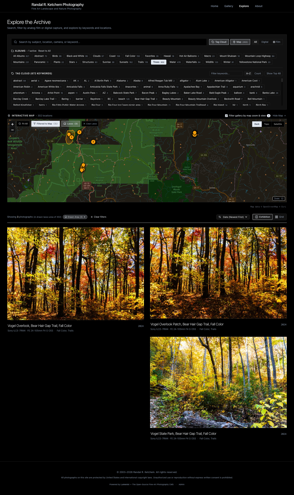
</p>

- **Real-Time Archive Search**: Instant multi-field search across titles, captions, stories, locations, camera gear, lenses, and film emulsions.
- **Curated Album Pills & Interactive Tag Cloud**: Concise, scrollable filter sections for rapid discovery by collection, biome, and keyword.
- **Embedded World Photography Map**: Interactive Leaflet map displaying shooting locations matching the active search, album, or tag filters with auto-clustering for dense field locations.
  - *3 Switchable Cartographic Layers*: Dark/Map Vector Tiles, Esri World Topographic, and Esri World Satellite Imagery.
  - *Map Zoom & Viewport Synchronization (Default On)*: Automatically filters the exhibition gallery below in real time to match photographs visible within the current map zoom and pan boundaries. Features a quick toggle switch in the map header bar and one-click filter removal pills.
  - *Freehand Lasso Selection*: Click and drag directly on the map (via mouse, stylus, or touchscreen) to encircle any arbitrary cluster of field locations; ray-casting point-in-polygon math instantly isolates and displays only the works from that hand-drawn boundary.
  - *Navigation & View Controls*: Includes a one-click *Fit All* button to re-center the full archive, real-time photo count badges, a zoom level indicator, and smart *"Filter to this area"* prompts.
  - *Exhibition Quick-Cards & List Sync*: Clicking any map pin reveals photo preview cards with exhibition details and lets you isolate and view those photographs in the gallery list below.
  - *Clean Route Redirect*: Direct navigation to `/map` automatically redirects to `/explore`.

### 🔍 Deep Technical Photo & Video Viewer (`/photo/[id]`)

<p align="center">
  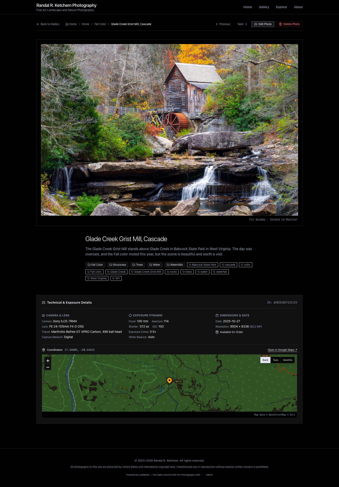
</p>

- **Adaptive Framing & Lightbox**: Pure OLED black or custom exhibition matting that fits horizontal, vertical, and panoramic orientations without clipping.
- **Native Video & External Embed Playback**: Supports both **self-hosted videos** (`.mp4`, `.webm`, `.mov`, `.m4v` streamed via HTTP `Range` requests with native HTML5 playback controls) and **privacy-enhanced external embeds** (YouTube via `youtube-nocookie.com` and Vimeo with `dnt=1`). Videos display a discreet play badge in gallery grids and automatically use a poster frame for thumbnails and map pins.
- **Keyboard & Touch Gestures**: Full keyboard navigation (Left/Right arrows for adjacent works, `F` for fullscreen, `Esc` to close) and mobile swipe gestures.
- **Discreet Copyright & Watermark Badge**: Configurable semi-transparent copyright overlay with an optional frosted shield in the corner of master previews.
- **Exposure Pyramid & Technical Drawer**: First-class display of:
  - **Exposure**: Shutter speed, aperture (f-number), ISO sensitivity, and exposure compensation (EV).
  - **Optics**: Camera body, lens model, and exact focal length in mm.
  - **Color & Film**: White balance Kelvin temperature and tint (e.g. `5200K +4`), film emulsion (e.g. *Fuji Velvia 50*, *Kodak Tri-X 400*) vs. digital capture.
  - **Support Gear**: Tripod body, ball head, and leveling base used in the field.
  - **Geospatial Pinpoint**: Dedicated mini-map illustrating the exact location of capture.
  - **Print Availability**: Edition and fine-art print ordering status.

### 📖 About & Artist Statement (`/about`)

<p align="center">
  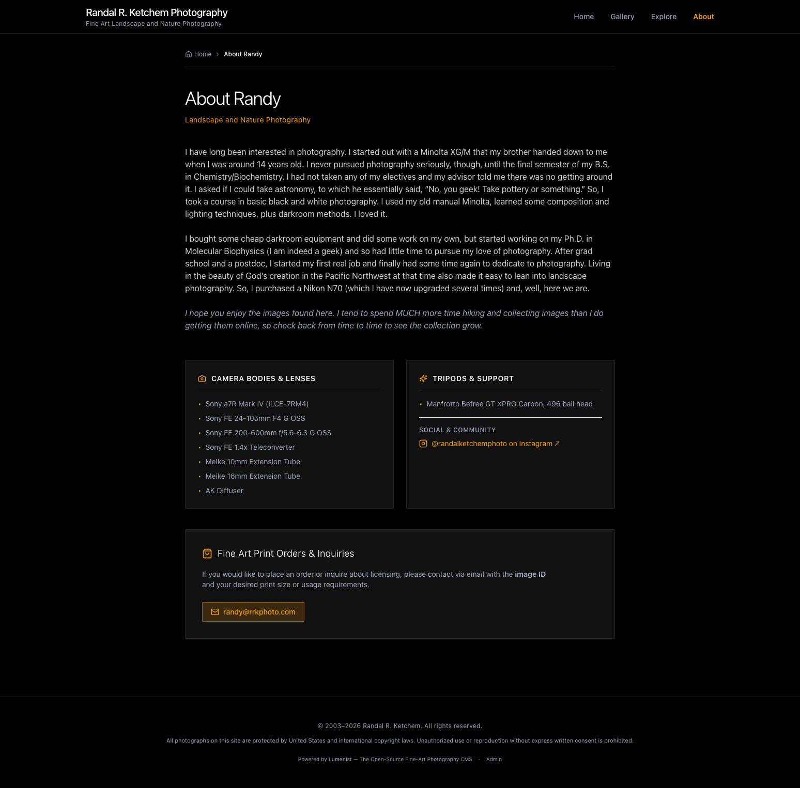
</p>

- Biography, photographic philosophy, list of field cameras/optics, exhibitions, and direct contact options.

---

## Integrated Web Admin Suite (`/admin`)

Lumenist includes a comprehensive, browser-based administrative suite accessed at `/admin` (or `/admin/upload`). Protected by cryptographically hashed credentials and signed HTTP cookies, it allows complete catalog management without touching code or database files.

```
┌────────────────────────────────────────────────────────────────────────┐
│  LUMENIST ADMIN SUITE                                                  │
├─────────────┬──────────────────────────┬───────────────┬───────────────┤
│  📁 UPLOAD  │  🖼️  MANAGE & BATCH      │  📚  ALBUMS   │  ⚙️  SETTINGS  │
└─────────────┴──────────────────────────┴───────────────┴───────────────┘
```

### 1. 📁 Upload (`?tab=upload`)

<p align="center">
  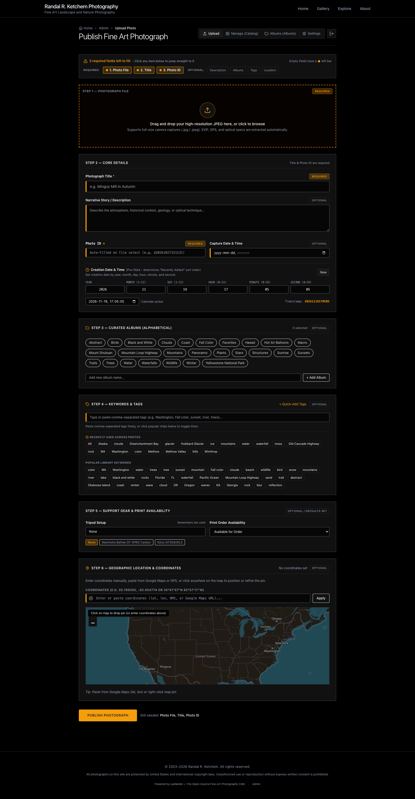
</p>

- **Multi-Format Image Publishing**: Drag and drop photographs in common formats (`.jpg`, `.jpeg`, `.png`, `.webp`, `.avif`, `.gif`, `.tif`/`.tiff`) directly into the live site. PNG transparency and GIF animation are preserved, and TIFFs are automatically converted to web-ready JPEGs.
- **Video Publishing (Self-Hosted & Embeds)**: Switch between **Photograph**, **Video (Self-Hosted MP4/WebM)**, and **Video (YouTube / Vimeo)** right in the upload form:
  - *Self-Hosted*: Upload `.mp4`, `.webm`, `.mov`, or `.m4v` clips directly in the browser, or reference a large file synced via CLI. Includes a copyable **Generic CLI Helper** (`ffmpeg` H.264 `+faststart` optimization, poster frame extraction, and `rsync` commands) for large videos that exceed reverse-proxy upload limits.
  - *YouTube / Vimeo Embeds*: Paste any YouTube or Vimeo link; YouTube poster thumbnails are fetched automatically if no custom cover image is uploaded.

<p align="center">
  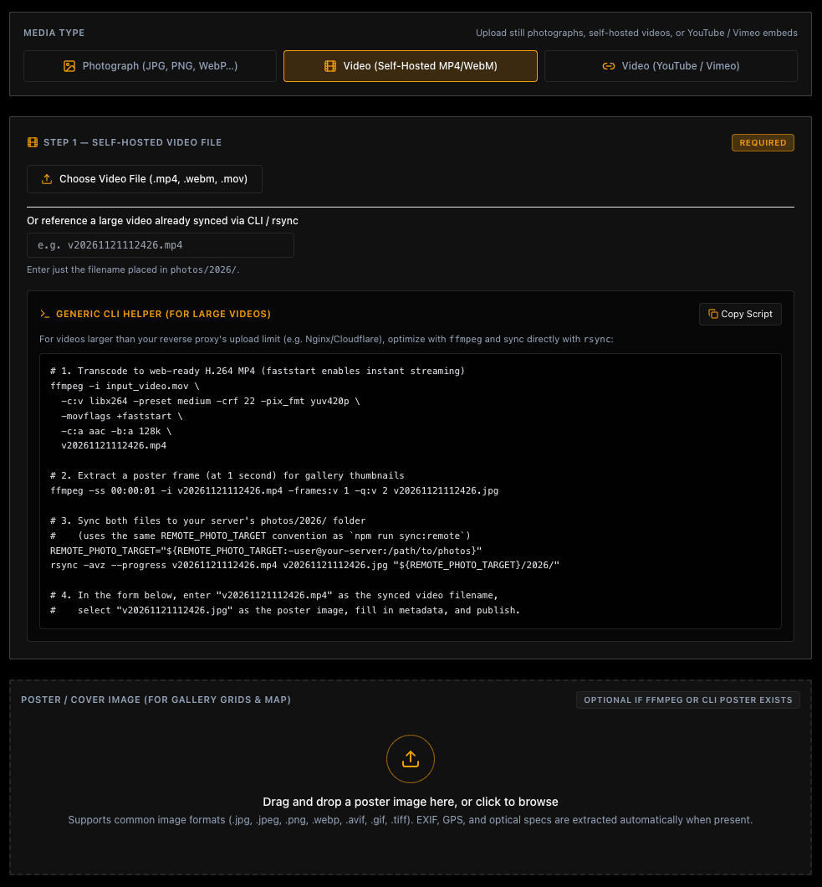
</p>

<p align="center">
  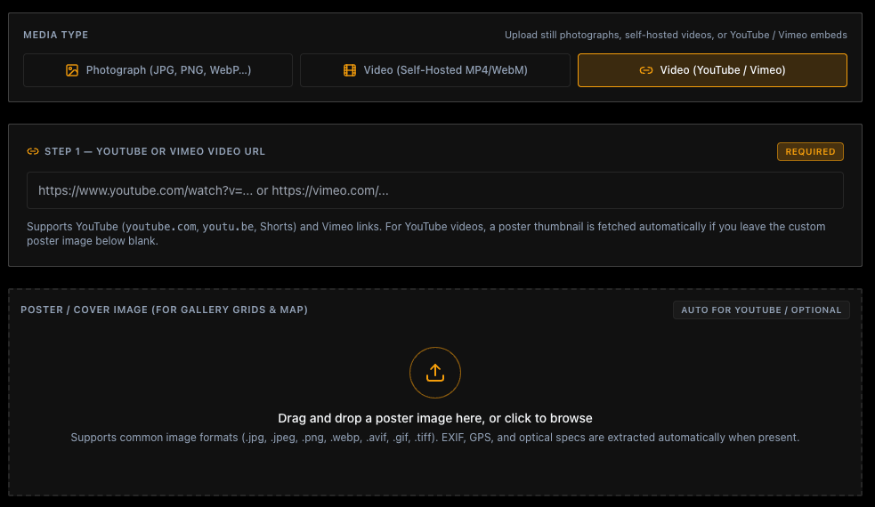
</p>
- **Automated Client-Side EXIF Extraction**: Automatically extracts camera make/model, lens, focal length, aperture, shutter speed, ISO, exposure compensation, Kelvin white balance, capture timestamp, and GPS coordinates when present.
- **Smart ID Generation**: Creates standardized IDs (`dYYYYMMDDHHMMSS` for photos, `vYYYYMMDDHHMMSS` for videos) derived from original timestamps.
- **Album Assignment**: Check existing albums or create new categories on the fly.
- **Interactive GPS Pin Picker**: Click or drag a pin on a built-in Leaflet map to set or fine-tune coordinates, or click *Clear Location* to remove GPS data.
- **Support Gear & Film Selectors**: Quick-pick dropdowns for tripod setups and film emulsions.
- **Bulk Import & Catalog Export (`Bulk Import` tab)**: Upload multiple images at once with an optional `.csv` or `.json` metadata manifest (rows match by `filename` or `photoID`, with EXIF auto-filling any missing camera, date, or GPS fields), preview matches before committing, choose duplicate handling (`Skip`, `Merge tags & albums`, or `Overwrite`), download sample CSV/JSON templates, and export your full `data/photos.json` catalog as JSON or CSV anytime.

### 2. 🖼️ Manage & Batch Operations (`?tab=manage`)

<p align="center">
  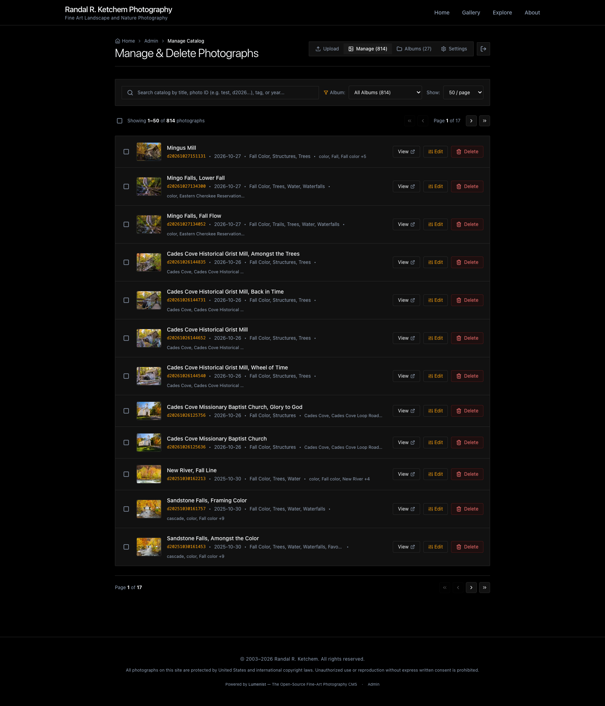
</p>

- **Full Catalog Archive Table**: Search and sort hundreds or thousands of photos with live search across titles, IDs, categories, and cameras.
- **Curation Filter**: Filter by individual album or select **"Only in All"** to isolate works that are not yet assigned to any curated gallery.
- **Configurable Page Density**: View 25, 50, 100, or All works per page.
- **Single Photo Editing**: Dedicated modal to edit any metadata field (title, story description, categories, tags, technical exposure, gear, and location coordinates).
- **Single Photo Deletion**: Delete an image with confirmation and automatic thumbnail cleanup.
- **Bulk Batch Operations**: Multi-select any combination of works (or select all matching filtered results) to perform:
  - **Bulk Add to Album**: Assign multiple photos to one or more existing or newly created albums.
  - **Bulk Remove from Album**: Remove multiple photos from a specific album in one step.
  - **Bulk Add Tags**: Add tags/keywords across selected works.
  - **Bulk Remove Tags**: Remove tags across selected works.
  - **Bulk Delete**: Delete selected photos with options to preserve or delete master files from the server disk.

### 3. 📚 Albums & Collection Management (`?tab=albums`)

<p align="center">
  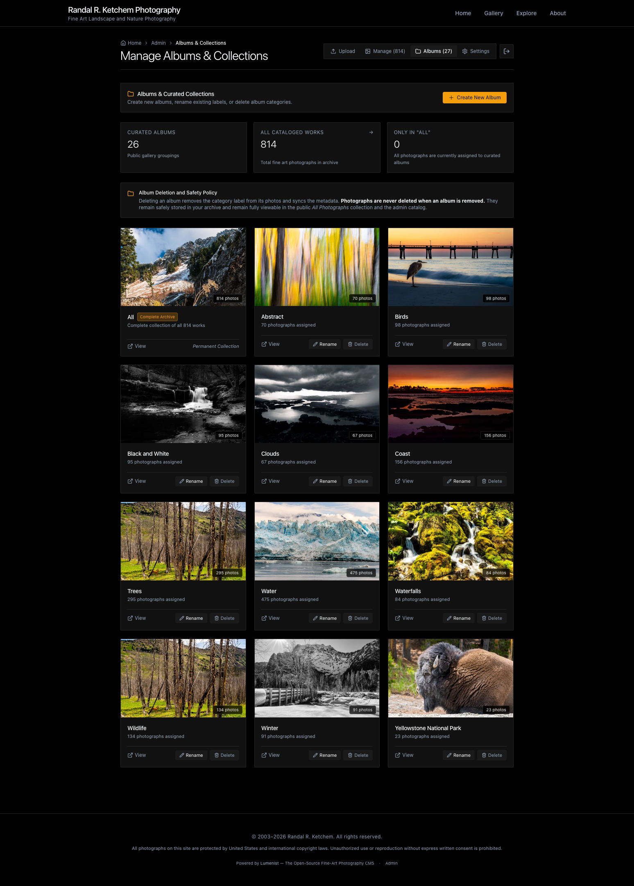
</p>

- **Album Grid Overview**: Visual gallery cards for every curated album showing the assigned cover photo, total count of contained works, and quick action buttons.
- **"All Photographs" Master Card**: High-level overview of the entire archive.
- **"Only in All" Quick Curation Card**: Surfaces the number of photographs that exist in the archive but have no curated album assignment. Clicking the card immediately opens the Manage tab pre-filtered to those images for quick curation.
- **Create New Album**: Add new curated galleries to the portfolio with a single click.
- **Rename Album**: Renames an album across every photograph in the catalog atomically, instantly updating all public URLs, gallery views, and photo metadata.
- **Safe Album Deletion**: Deleting an album removes the album category label from all member photos while **safely preserving the photos themselves** in the archive ("All").

### 4. ⚙️ Studio Settings & Dynamic Theming (`?tab=settings`)

<p align="center">
  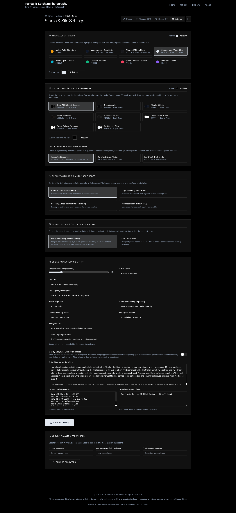
</p>

- **Studio Identity**: Update Artist Name, Site Title, Tagline, Bio, and copyright notices live from the browser without server restarts.
- **Watermark & Protection Engine**: Toggle the public copyright overlay badge on or off, configure custom copyright strings, and enable/disable the frosted glass shield backing.
- **Exhibition Theme Presets**: Choose between Pure OLED Black (`#000000`), Midnight Slate, Charcoal, Warm Espresso, Studio White, Gallery Parchment, or Soft Silver.
- **Accent Color Engine**: 6 hand-tuned presets (Amber Gold, Pure Silver, Pacific Cyan, Cascade Emerald, Alpine Crimson, Amethyst Violet) plus a custom hex picker. Includes automatic contrast calculation to guarantee WCAG-compliant legibility across all backgrounds.
- **Slideshow Timing**: Adjust the auto-advance dwell time (seconds) for the homepage hero carousel.
- **Passphrase Management**: Securely update the administrative passphrase with instant bcrypt re-hashing.

---

## Technical Architecture & Pipeline

### ⚡ On-Demand WebP Image & Video Streaming Pipeline
- **On-Demand Thumbnailer (`/api/thumbnail`)**: Powered by high-speed **Sharp** native C++ image bindings with Lanczos3 resampling across JPG, PNG, WebP, AVIF, and GIF sources.
  - Dynamic query parameters: `/api/thumbnail?src=/photos/2026/image.jpg&w=1200&fmt=webp&q=85`.
  - **Two-Tier Caching**: Processed WebP images are cached to `.thumbnails/` on disk for sub-5ms subsequent delivery with `Cache-Control: public, max-age=31536000, immutable` headers.
  - **Batch Pre-caching CLI**: Pre-render all exhibition thumbnails before launching major portfolios using `npm run thumbnails:precache`.
- **HTTP Range Video Streaming (`/photos/[...slug]`)**: Serves images and streams self-hosted videos (`.mp4`, `.webm`, `.mov`, `.m4v`) via `fs.createReadStream` with `Accept-Ranges: bytes`, `HEAD`, and `206 Partial Content` support for instant seeking and Safari/mobile playback without buffering large videos in RAM.

### 🔒 Security & Persistence
- **Zero Database Lock-in**: All portfolio metadata is maintained in transparent, versionable JSON files in `data/` (`photos.json`, `settings.json`, `auth.json`).
- **Stateless Session Tokens**: Admin authentication utilizes HMAC-SHA256 / AES session cookies signed with `ADMIN_SECRET`.
- **CSRF & Route Protection**: Administrative REST APIs validate session authenticity before executing mutations.

---

## Server Installation & Setup Guide

This guide covers installing and deploying Lumenist on an Ubuntu/Debian Linux server (e.g. Oracle Cloud, DigitalOcean, Hetzner, AWS, or a dedicated home lab server).

### Prerequisites
- **Ubuntu 22.04 / 24.04 LTS** (or Debian 12)
- **Node.js 20+ or 22 LTS**
- **Nginx** (reverse proxy & SSL termination)
- **PM2** (process manager for zero-downtime restarts)
- **FFmpeg** *(optional)* — enables automatic server-side poster frame extraction when uploading self-hosted videos without a custom cover image
- A registered domain name pointing to your server's public IP

```bash
# Update packages and install Node.js 22 LTS & essential tools
curl -fsSL https://deb.nodesource.com/setup_22.x | sudo -E bash -
sudo apt install -y nodejs nginx git certbot python3-certbot-nginx

# Install PM2 globally
sudo npm install -g pm2
```

---

### Step 1: Clone the Repository

```bash
sudo mkdir -p /var/www/lumenist
sudo chown -R $USER:$USER /var/www/lumenist

git clone https://github.com/ketchemr/lumenist.git /var/www/lumenist
cd /var/www/lumenist
```

### Step 2: Install Dependencies

```bash
npm install
```

### Step 3: Configure Environment Variables

Create your server environment file from the template:

```bash
cp .env.example .env.local
```

Edit `.env.local` to define your secure administrator credentials:

```env
# Administrative Passphrase for /admin access
ADMIN_PASSWORD=your-secure-admin-passphrase

# 32+ character random secret used for session token signing
ADMIN_SECRET=generate-a-secure-random-secret-string-here
```

### Step 4: Set Up Your Photo Directory

Lumenist serves high-resolution photos via `public/photos`. You can symlink an existing photo drive, storage volume, or dedicated folder:

```bash
# Example: Symlinking a dedicated photo storage directory
ln -s /var/photos /var/www/lumenist/public/photos
```

Organize your photo files by year or category (e.g. `public/photos/2026/my_photo.jpg`).

### Step 5: Bulk Import Your Initial Photo Catalog

Lumenist stores your entire catalog in `data/photos.json` and automatically extracts image dimensions, capture date/time, camera, lens, exposure settings, and GPS coordinates from EXIF/XMP headers. You can seed your initial library using either the **CLI batch importer** (best for large archives) or the **Web Admin Bulk Import tab** (best for smaller batches).

#### Option A: CLI Batch Importer (Recommended for Large Initial Libraries)

Point `npm run import:batch` at a folder of images (`.jpg`, `.jpeg`, `.png`, `.webp`, `.avif`, `.gif`)—with an optional `.csv` or `.json` metadata manifest:

```bash
# Import a folder of images using EXIF metadata only
npm run import:batch -- /path/to/your/photos

# Import images with a CSV or JSON metadata manifest
npm run import:batch -- /path/to/your/photos --meta /path/to/manifest.csv

# Re-run to merge updated tags/albums into existing catalog entries
npm run import:batch -- /path/to/your/photos --meta /path/to/manifest.json --duplicates merge
```

Rows in the manifest match images by `filename` or `photoID`. Any image without a matching row is still imported using its EXIF metadata.

**Example CSV manifest (`manifest.csv`):**

```csv
filename,photoID,title,description,albums,tags,latitude,longitude,year,month,day,film,tripod
autumn_trail.jpg,d20261015083000,"Autumn Forest Trail","Morning mist drifting through maples along the ridge trail.","Fall Color, Trees","autumn, forest, mist, trail",44.3386,-68.2733,2026,10,15,Digital,"Carbon Tripod"
```

**Example JSON manifest (`manifest.json`):**

```json
[
  {
    "filename": "autumn_trail.jpg",
    "photoID": "d20261015083000",
    "title": "Autumn Forest Trail",
    "description": "Morning mist drifting through maples along the ridge trail.",
    "albums": ["Fall Color", "Trees"],
    "tags": ["autumn", "forest", "mist", "trail"],
    "latitude": 44.3386,
    "longitude": -68.2733
  }
]
```

> **Supported optional fields:** `filename`, `photoID`, `title`, `description`, `albums` (or `categories`), `tags` (or `keywords`), `location` (`"lat,lon"`) or `latitude`/`longitude`, `date` or `year`/`month`/`day`/`hour`/`minute`/`second`, `folder`, `film`, `camera`, `lens`, `focalLength`, `shutterspeed`, `aperture`, `sensitivity`, `tripod`, and `availability`. Duplicate handling supports `--duplicates skip` (default), `merge` (merges new tags/albums without losing existing metadata), or `overwrite`.

#### Option B: Web Admin Bulk Import (`/admin/upload` → `Bulk Import`)

Once the app is running, sign in to `/admin`, open the **Bulk Import** tab, select multiple images plus an optional `.csv` or `.json` manifest (sample templates are downloadable right in the UI), review the match preview table, and click **Import**. You can also export a full JSON or CSV backup of your catalog from the same tab anytime.

*(Recommended)* Pre-cache WebP thumbnails for instant exhibition loading:

```bash
npm run thumbnails:precache
```

### Step 6: Build & Launch with PM2

Build the optimized production application:

```bash
npm run build
```

Start the application with PM2:

```bash
# Start Lumenist on port 3000
pm2 start npm --name "lumenist" -- start

# Configure PM2 to automatically start on server boot
pm2 startup
pm2 save
```

### Step 7: Configure Nginx & SSL

Create an Nginx configuration file for your domain:

```bash
sudo nano /etc/nginx/sites-available/lumenist
```

Paste the following production configuration (replace `your-domain.com` with your actual domain):

```nginx
server {
    server_name your-domain.com www.your-domain.com;

    # Allow high-resolution photo uploads through /admin
    client_max_body_size 100M;

    location / {
        proxy_pass http://127.0.0.1:3000;
        proxy_http_version 1.1;
        proxy_set_header Upgrade $http_upgrade;
        proxy_set_header Connection 'upgrade';
        proxy_set_header Host $host;
        proxy_cache_bypass $http_upgrade;
        proxy_set_header X-Real-IP $remote_addr;
        proxy_set_header X-Forwarded-For $proxy_add_x_forwarded_for;
        proxy_set_header X-Forwarded-Proto $scheme;
    }

    # Serve pre-generated thumbnails with aggressive client caching
    location /.thumbnails/ {
        alias /var/www/lumenist/.thumbnails/;
        expires 30d;
        add_header Cache-Control "public, max-age=2592000, immutable";
    }

    listen 80;
}
```

Enable the site and reload Nginx:

```bash
sudo ln -s /etc/nginx/sites-available/lumenist /etc/nginx/sites-enabled/
sudo nginx -t
sudo systemctl reload nginx
```

Obtain a free SSL certificate with Let's Encrypt:

```bash
sudo certbot --nginx -d your-domain.com -d www.your-domain.com
```

---

## REST API Reference

Lumenist exposes clean, typed Next.js App Router API endpoints:

| Endpoint | Method | Auth | Description |
| :--- | :--- | :--- | :--- |
| `/photos/[...slug]` | `GET` / `HEAD` | Public | Serves images and streams self-hosted videos with HTTP `Range` (`206 Partial Content`) support. |
| `/api/thumbnail` | `GET` | Public | Generates and serves cached, optimized WebP thumbnails. |
| `/api/admin/auth` | `POST` / `DELETE` | Public / Cookie | Verifies admin passphrase, creates session cookie, or logs out. |
| `/api/admin/upload` | `POST` | Admin | Receives image/video binaries, embed URLs, and metadata payloads; writes to disk and catalog. |
| `/api/admin/photos` | `GET` | Admin | Retrieves paginated and filtered catalog records for admin table. |
| `/api/admin/photo/[id]` | `PUT` / `DELETE` | Admin | Updates or deletes an individual photo record. |
| `/api/admin/photos/bulk` | `POST` | Admin | Executes bulk actions (`addAlbums`, `removeAlbums`, `addTags`, `removeTags`, `delete`). |
| `/api/admin/albums` | `POST` / `PUT` / `DELETE` | Admin | Creates, renames, or deletes albums while preserving photos. |
| `/api/admin/settings` | `GET` / `PUT` | Public / Admin | Reads public studio settings or updates configuration/theme. |
| `/api/admin/metadata` | `GET` | Admin | Returns distinct lists of existing categories, tags, lenses, and cameras for auto-completion. |

---

## Photo Metadata Specification

Every photograph in Lumenist adheres to a strict, typed TypeScript schema (`src/types/photo.ts`):

```typescript
export interface Photo {
  // Identity & Story (Curated / Companion Metadata)
  photoID: string;              // e.g. "d20261027151131" (or auto-generated from EXIF timestamp)
  title: string;                // e.g. "Mingus Mill in Autumn" (Curated)
  description: string;          // Rich narrative and history (Curated)
  availability: string;         // e.g. "Available for Order", "Private Collection" (Curated)
  
  // Organization (Curated)
  categories: string[];         // ["Fall Color", "Historic Structures", "Water"]
  tags: string[];               // ["Mingus Mill", "Great Smoky Mountains", "Pioneer"]
  
  // Chronology (Derived from EXIF DateTimeOriginal / CreateDate)
  dateTaken: string;            // ISO formatted timestamp (e.g. "2026-10-27T15:11:31")
  year: number;                 // e.g. 2026
  
  // Camera & Optics (Derived from EXIF / XMP)
  camera: string;               // e.g. "Sony ILCE-7RM4" (EXIF Make + Model)
  lens: string;                 // e.g. "Sony FE 24-105mm F4 G OSS" (EXIF LensModel / Lens)
  focalLength: string;          // e.g. "24 mm" (EXIF FocalLength)
  shutterspeed: string;         // e.g. "1/15 s" or "2.5 s" (EXIF ExposureTime)
  aperture: string;             // e.g. "f/14" (EXIF FNumber)
  iso: string;                  // e.g. "100" (EXIF ISO / PhotographicSensitivity)
  exposureCompensation: string; // e.g. "0 EV", "+0.7 EV" (EXIF ExposureCompensation)
  whiteBalance: string;         // e.g. "5200K +4" or "Auto" (XMP Temperature + Tint / WhiteBalance)
  toneCompensation: string;     // e.g. "Auto" (EXIF / XMP tone curve)

  // Physical Craft & Support (Curated / Companion Metadata)
  film: string;                 // "Digital" (auto-detected from EXIF) or film stock ("Fuji Velvia 50", "Kodak Tri-X")
  tripod: string;               // e.g. "Gitzo GT3543LS Systematic, Really Right Stuff BH-55"

  // Geospatial Coordinates (Derived from EXIF GPS or picked via Admin Map)
  latitude: number | null;      // Decimal latitude (e.g. 35.5312)
  longitude: number | null;     // Decimal longitude (e.g. -83.3094)

  // Dimensions & Aspect Ratio (Derived from Image File Headers for Zero-CLS Layout)
  width: number;                // Pixel width (e.g. 1920)
  height: number;               // Pixel height (e.g. 1080)
  aspectRatio: number;          // e.g. 1.777
  orientation: "horizontal" | "vertical" | "square";

  // File Paths & Video Support (System Managed / Optional)
  imageDesktop: string;         // Relative URL to master display image or video poster (/photos/...)
  imageThumb: string;           // On-demand thumbnail endpoint (/api/thumbnail?src=...)
  mediaType?: "photo" | "video";// Defaults to "photo"
  videoSrc?: string;            // Self-hosted video path (e.g. "/photos/2026/v20261121.mp4")
  videoEmbedUrl?: string;       // External YouTube or Vimeo URL
}
```

---

## Project Structure

```
lumenist/
├── data/                      # Persistent JSON catalog (git-ignored)
│   ├── photos.json            # Unified photo metadata archive
│   ├── settings.json          # Studio and theme settings
│   └── auth.json              # Hashed admin credentials
├── public/
│   ├── photos/                # Symlink or folder for full-res master photos
│   └── favicon.ico            # Site favicon
├── scripts/
│   ├── import-batch.ts        # CLI batch importer for images + optional CSV/JSON manifest
│   ├── precache-thumbnails.js # Pre-caches WebP thumbnails across widths
│   └── tag-photos.py          # Optional AI vision + GPS tag enricher for data/photos.json
├── src/
│   ├── app/                   # Next.js 15 App Router
│   │   ├── layout.tsx         # Root layout with dynamic theme CSS variables
│   │   ├── page.tsx           # Home page: Hero slideshow + Curated galleries
│   │   ├── admin/             # Web Admin suite (/admin, /admin/upload)
│   │   ├── api/               # API routes (auth, albums, metadata, photos, bulk, thumbnails)
│   │   ├── galleries/         # Curated gallery exhibition views ([category]/page.tsx)
│   │   ├── photo/[id]/        # Individual photo showcase, lightroom, & technical drawer
│   │   ├── explore/           # Archive search, interactive map with zoom & freehand lasso filtering, and exhibition galleries
│   │   ├── map/               # Global photography map with multi-layer raster/vector tiles
│   │   └── about/             # Artist statement & bio
│   ├── components/            # Reusable UI components (Leaflet maps, Hero, Lightbox, etc.)
│   ├── config/                # Site defaults and navigation configuration
│   ├── lib/                   # Photos parser, auth helpers, settings engine, EXIF utilities
│   └── types/                 # TypeScript interfaces (Photo, Settings, EXIF)
└── tailwind.config.ts         # Tailwind design system with semantic CSS variables
```

---

## Built with Lumenist

A curated gallery of live photography portfolios powered by Lumenist:

| Site | Photographer | Focus |
| :--- | :--- | :--- |
| [rrkphoto.com](https://rrkphoto.com) | Randal R. Ketchem | Fine-art landscape and nature photography |

**Using Lumenist for your portfolio?** If you'd like your site considered for this showcase, please send your site URL and a brief description privately via the contact options on [rrkphoto.com/about](https://rrkphoto.com/about).

> *Showcase guidelines: Listings are limited to family-friendly, original photography portfolios. All submissions are manually reviewed prior to listing and are included at the maintainer's discretion; links may be removed if a site goes offline or its content changes.*

---

## License

This project is licensed under the **MIT License** — you are free to self-host, customize, and extend it for your own photography portfolio.
